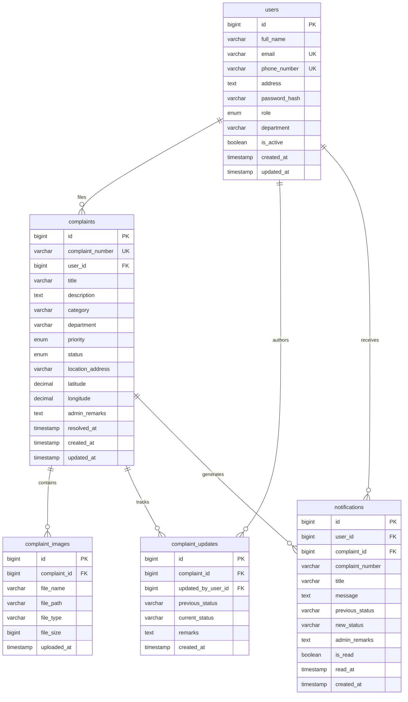
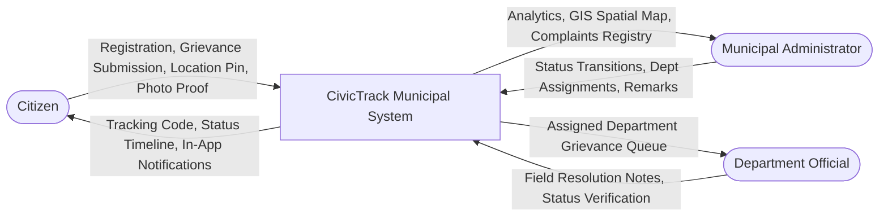
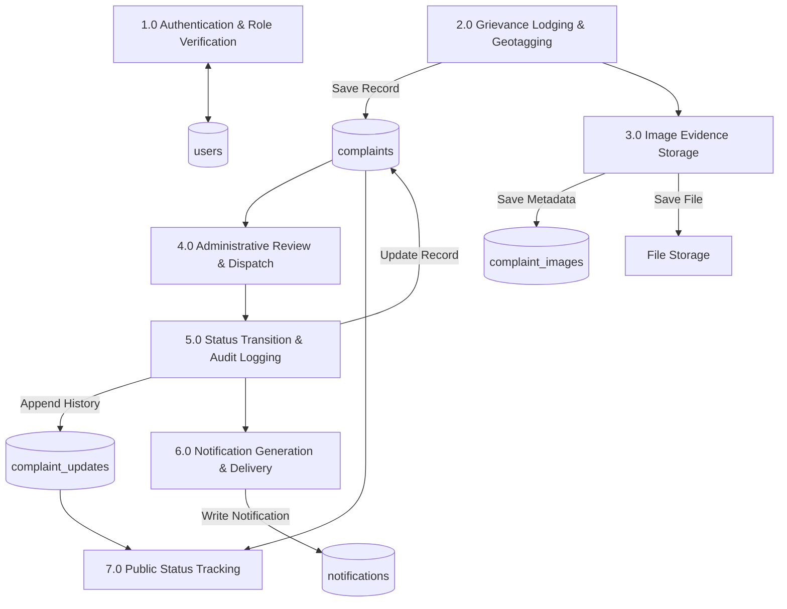

# CivicTrack: Comprehensive College Project Documentation & Deployment Guide

> **Project Title:** CivicTrack – Municipal Public Grievance Redressal and Spatial Tracking System  
> **Academic Level:** Bachelor of Technology / Bachelor of Engineering (Computer Science & Information Technology)  
> **Backend Architecture:** Java 21, Spring Boot 3.3, Spring Security 6 (JWT), Spring Data JPA, Hibernate  
> **Database:** MySQL 8.0+ Relational Database Management System  
> **Frontend Architecture:** HTML5, CSS3, JavaScript (ES6+), Bootstrap 5.3, Chart.js 4.4, Leaflet.js 1.9, OpenStreetMap  
> **Deployment Targets:** Vercel / Netlify (Client Frontend), Render / Railway (Spring Boot Web Service), Managed Cloud MySQL  

---

## Table of Contents
1. [Project Abstract](#1-project-abstract)
2. [Problem Statement](#2-problem-statement)
3. [Project Objectives](#3-project-objectives)
4. [Existing System vs. Proposed System](#4-existing-system-vs-proposed-system)
5. [Hardware & Software Requirements](#5-hardware--software-requirements)
6. [System Architecture](#6-system-architecture)
7. [Database Design & Data Dictionary](#7-database-design--data-dictionary)
8. [Entity-Relationship (ER) Diagram](#8-entity-relationship-er-diagram)
9. [Data Flow Diagrams (DFD Level 0, 1, 2)](#9-data-flow-diagrams-dfd)
10. [Module Descriptions](#10-module-descriptions)
11. [REST API Documentation](#11-rest-api-documentation)
12. [Installation & Local Setup Guide](#12-installation--local-setup-guide)
13. [Production Cloud Deployment Guide (Vercel, Netlify, Render, Railway, MySQL)](#13-production-cloud-deployment-guide)
14. [Comprehensive Testing & Verification Report](#14-comprehensive-testing--verification-report)
15. [Security & Privacy Engineering](#15-security--privacy-engineering)
16. [Future Enhancements](#16-future-enhancements)

---

## 1. Project Abstract

**CivicTrack** is an enterprise-grade, full-stack municipal grievance redressal and spatial tracking platform. In contemporary urban ecosystems, civic issues such as hazardous potholes, overflowing solid waste bins, ruptured potable water pipelines, and non-functional streetlights degrade municipal quality of life, cause vehicular accidents, and waste public resources. 

CivicTrack addresses this divide by providing an intuitive, transparent, and bidirectional digital bridge between citizens, municipal field crews, and urban administrative heads. Built upon **Java 21 LTS**, **Spring Boot 3.3.5**, and **Spring Security 6 with stateless JSON Web Tokens (JWT)**, the platform enforces strict role-based access control (`ROLE_CITIZEN`, `ROLE_ADMIN`, `ROLE_STAFF`, `ROLE_OFFICIAL`). 

Citizens can file grievances with device-level **GPS geolocation**, manual pinpoint placement on **OpenStreetMap via Leaflet.js**, and multipart photographic evidence. Administrators monitor municipal performance via **Chart.js** analytics, dispatch department teams across a full-screen **Geographic Information System (GIS)** interface with status-coded markers, and publish progress updates. These actions trigger **real-time, database-persisted in-app notifications** to citizens.

---

## 2. Problem Statement

Traditional civic governance systems in municipal corporations suffer from structural operational inefficiencies:
1. **Untraceable & Opaque Logging:** Grievances logged via paper registers, physical complaint boxes, or telephonic lines are frequently misfiled, duplicated, or lost without an audit trail.
2. **Ambiguous Incident Geolocation:** Verbal or informal descriptions (e.g., *"near the big banyan tree behind the market"*) force field engineers to expend hours locating the exact problem site.
3. **Absence of Photographic Evidence:** Repair contractors often lack visual clarity regarding the magnitude of damage (e.g., superficial road cracking vs. 2-foot structural asphalt cave-in), resulting in inaccurate machinery dispatch.
4. **Zero Citizen Visibility & Lack of SLA Enforcement:** Citizens receive no real-time status updates after lodging a complaint, leading to cynicism, apathy, and repetitive escalation calls.
5. **Departmental Silos:** Municipal departments (Public Works, Water Supply, Solid Waste, Street Lighting) operate in isolation without unified administrative oversight or performance metrics.

---

## 3. Project Objectives

1. **Streamlined Citizen Reporting:** Provide a responsive, zero-friction web portal for citizens to register grievances in under 90 seconds with automated department routing.
2. **Precision Spatial Geotagging:** Enable hardware-accelerated GPS capture and interactive Leaflet.js map pinning with citizen privacy safeguards.
3. **Photographic Verification:** Enforce visual evidence uploads with client-side drag-and-drop validation and secure server-side file management.
4. **End-to-End SLA Transparency:** Implement a 5-stage visual lifecycle timeline (`SUBMITTED` $\to$ `UNDER_REVIEW` $\to$ `ASSIGNED` $\to$ `IN_PROGRESS` $\to$ `RESOLVED`/`REJECTED`) accessible via public tracking codes.
5. **Administrative GIS Operations & Analytics:** Equip municipal leaders with macro-level spatial hotspot maps, category distributions, and monthly redressal charts.
6. **Live In-App Notification System:** Automatically notify citizens upon official status transitions and administrative directive updates.
7. **Cloud-Native Deployment:** Ensure production readiness across modern cloud platforms (Vercel, Netlify, Render, Railway, and Managed MySQL).

---

## 4. Existing System vs. Proposed System

| Dimension | Existing Municipal System | CivicTrack Proposed System |
|---|---|---|
| **Submission Mode** | Physical municipal counters, paper petitions, calls | 24x7 responsive web application accessible on phones & desktops |
| **Location Precision** | Approximate handwritten text descriptions | Hardware GPS latitude/longitude + Leaflet OpenStreetMap pin |
| **Visual Proof** | Absent or unlinked paper printouts | High-resolution photographic evidence upload with preview |
| **Tracking Mechanism** | Manual enquiry via telephone or physical visits | Instant online tracking code (`GRV-YYYY-XXXX`) with 5-stage timeline |
| **Citizen Feedback** | No proactive alerts | Automatic in-app notification alerts stored in MySQL |
| **Administrative Control**| Isolated physical registers | Centralized GIS spatial map, department reassignment, & Chart.js |
| **Security** | Unprotected manual ledgers | BCrypt password hashing & stateless JWT bearer authorization |

---

## 5. Hardware & Software Requirements

### 5.1 Software Requirements

#### Development & Server Environment
- **Operating System:** Windows 10/11, Ubuntu 22.04 LTS, macOS Sonoma
- **Java Development Kit:** Eclipse Adoptium OpenJDK 21 LTS (HotSpot)
- **Backend Framework:** Spring Boot 3.3.5 (Spring Web, Spring Data JPA, Spring Security 6)
- **JWT Library:** `io.jsonwebtoken:jjwt-api:0.12.5`
- **Database Engine:** MySQL 8.0+ Community Server or Managed Cloud MySQL (Railway / Aiven / RDS)
- **Database Management Tool:** MySQL Workbench 8.0 CE or DBeaver Community
- **Build Automation Tool:** Apache Maven 3.9+
- **Containerization:** Docker Engine 24+ & Docker Compose

#### Client & Frontend Technologies
- **Markup & Styling:** HTML5, CSS3, Bootstrap 5.3.3, Bootstrap Icons 1.11.3
- **Scripting Language:** JavaScript (ECMAScript 2022+ / ES6)
- **Mapping Engine:** Leaflet.js 1.9.4 & OpenStreetMap Tiles
- **Data Visualization:** Chart.js 4.4.2
- **Supported Browsers:** Google Chrome 110+, Mozilla Firefox 110+, Apple Safari 16+, Microsoft Edge 110+

### 5.2 Hardware Requirements

#### Recommended Server Specifications (Production / Staging)
- **Processor:** Dual-Core 64-bit x86_64 / ARM64 processor (2.0 GHz or higher)
- **Random Access Memory (RAM):** 2 GB minimum (4 GB recommended for concurrent JVM & MySQL instances)
- **Disk Storage:** 20 GB SSD storage (accommodates persistent multipart uploads)
- **Network Interface:** 100 Mbps broadband connection with static IP or cloud domain

#### Client Machine / Mobile Specifications
- **Mobile Smartphone:** Android 8.0+ or iOS 13+ with GPS geolocation capability (Screen resolution $\ge 360\text{px}$)
- **Desktop / Laptop:** 1.5 GHz Dual-Core processor, 2 GB RAM, 1024x768 display resolution or higher

---

## 6. System Architecture

CivicTrack is architected as a **decoupled, multi-tiered (N-Tier) cloud-native web system** adhering to enterprise domain-driven design and separation of concerns.

```mermaid
flowchart TD
    subgraph ClientTier["Client Presentation Tier (Browser / Mobile)"]
        A1["Citizen Web App\n(HTML5, CSS3, ES6)"]
        A2["Municipal Admin Console\n(Dashboard, GIS Map)"]
        A3["Leaflet.js & OpenStreetMap\n(GPS Geolocation)"]
    end

    subgraph GatewayTier["API Gateway & Reverse Proxy Tier"]
        B1["Vercel / Netlify / NGINX\n(HTTPS, Static Edge, Rewrites)"]
    end

    subgraph SecurityTier["Security & Filter Tier"]
        C1["CorsFilter\n(CORS Validation)"]
        C2["JwtAuthenticationFilter\n(Bearer Token Parser)"]
        C3["SecurityFilterChain\n(Role Guards: CITIZEN, ADMIN, STAFF)"]
    end

    subgraph ControllerTier["REST Controller Layer"]
        D1["AuthController\n(/api/v1/auth)"]
        D2["ComplaintController\n(/api/v1/complaints)"]
        D3["AdminController\n(/api/v1/admin)"]
        D4["NotificationController\n(/api/v1/notifications)"]
        D5["DashboardController\n(/api/v1/dashboard)"]
    end

    subgraph ServiceTier["Business Service Layer"]
        E1["AuthService / UserService"]
        E2["ComplaintService"]
        E3["AdminService"]
        E4["NotificationService"]
        E5["FileStorageService"]
    end

    subgraph PersistenceTier["Spring Data JPA Repository Layer"]
        F1["UserRepository"]
        F2["ComplaintRepository"]
        F3["ComplaintImageRepository"]
        F4["ComplaintUpdateRepository"]
        F5["NotificationRepository"]
    end

    subgraph DataStorageTier["Persistent Storage Tier"]
        G1[("MySQL 8.0 Database\n(civictrack)")]
        G2["Persistent File Volume\n(/var/data/uploads)"]
    end

    ClientTier -->|HTTPS / JSON REST / Multipart| GatewayTier
    GatewayTier --> SecurityTier
    SecurityTier --> ControllerTier
    ControllerTier --> ServiceTier
    ServiceTier --> PersistenceTier
    ServiceTier --> G2
    PersistenceTier --> G1
```



---

## 7. Database Design & Data Dictionary

The CivicTrack database (`civictrack`) contains five interconnected tables normalized to Third Normal Form (3NF).

### Table 1: `users`
Stores credentials, roles, and profiles for citizens, municipal officials, and system administrators.

| Column Name | Data Type | Constraints | Description |
|---|---|---|---|
| `id` | BIGINT | PRIMARY KEY, AUTO_INCREMENT | Unique user identifier |
| `full_name` | VARCHAR(100) | NOT NULL | Legal name of user |
| `email` | VARCHAR(100) | NOT NULL, UNIQUE, INDEX | Unique email for authentication |
| `phone_number` | VARCHAR(20) | UNIQUE, NULLABLE | Contact telephone number |
| `address` | TEXT | NULLABLE | Physical residential address |
| `password_hash` | VARCHAR(255) | NOT NULL | Salted BCrypt password hash |
| `role` | ENUM | NOT NULL, DEFAULT 'ROLE_CITIZEN' | `ROLE_CITIZEN`, `ROLE_ADMIN`, `ROLE_STAFF`, `ROLE_OFFICIAL` |
| `department` | VARCHAR(100) | NULLABLE | Department name for municipal staff |
| `is_active` | BOOLEAN | NOT NULL, DEFAULT TRUE | Account operational status |
| `created_at` | TIMESTAMP | NOT NULL, DEFAULT CURRENT_TIMESTAMP | Registration timestamp |
| `updated_at` | TIMESTAMP | NOT NULL, ON UPDATE CURRENT_TIMESTAMP | Last modification timestamp |

### Table 2: `complaints`
Core repository of citizen grievances with GIS spatial coordinates and department assignments.

| Column Name | Data Type | Constraints | Description |
|---|---|---|---|
| `id` | BIGINT | PRIMARY KEY, AUTO_INCREMENT | Unique internal grievance ID |
| `complaint_number` | VARCHAR(50) | NOT NULL, UNIQUE, INDEX | Public tracking code (`GRV-YYYY-XXXX`) |
| `user_id` | BIGINT | NOT NULL, FK $\to$ `users(id)` | Foreign key referencing citizen creator |
| `title` | VARCHAR(200) | NOT NULL | Brief summary of the civic problem |
| `description` | TEXT | NOT NULL | Comprehensive citizen problem statement |
| `category` | VARCHAR(100) | NOT NULL, INDEX | Issue category (e.g. Road Damage, Drainage) |
| `department` | VARCHAR(100) | NOT NULL, DEFAULT 'PWD' | Assigned municipal department |
| `priority` | ENUM | NOT NULL, DEFAULT 'MEDIUM' | `LOW`, `MEDIUM`, `HIGH`, `CRITICAL` |
| `status` | ENUM | NOT NULL, DEFAULT 'SUBMITTED', INDEX | `SUBMITTED`, `UNDER_REVIEW`, `ASSIGNED`, `IN_PROGRESS`, `RESOLVED`, `REJECTED` |
| `location_address`| VARCHAR(255) | NOT NULL | Street location or landmark |
| `latitude` | DECIMAL(10, 8)| NULLABLE | WGS 84 GPS Latitude coordinate |
| `longitude` | DECIMAL(11, 8)| NULLABLE | WGS 84 GPS Longitude coordinate |
| `admin_remarks` | TEXT | NULLABLE | Official directives or resolution summary |
| `resolved_at` | TIMESTAMP | NULLABLE | Timestamp of certification as resolved |
| `created_at` | TIMESTAMP | NOT NULL, DEFAULT CURRENT_TIMESTAMP, INDEX | Complaint registration timestamp |
| `updated_at` | TIMESTAMP | NOT NULL, ON UPDATE CURRENT_TIMESTAMP | Last lifecycle update timestamp |

### Table 3: `complaint_images`
Manages photographic evidence and metadata uploaded with complaints.

| Column Name | Data Type | Constraints | Description |
|---|---|---|---|
| `id` | BIGINT | PRIMARY KEY, AUTO_INCREMENT | Unique attachment identifier |
| `complaint_id` | BIGINT | NOT NULL, FK $\to$ `complaints(id)` | Associated complaint reference |
| `file_name` | VARCHAR(255) | NOT NULL | Original client filename |
| `file_path` | VARCHAR(500) | NOT NULL | Storage path on disk or relative URL |
| `file_type` | VARCHAR(100) | NULLABLE | MIME content type (e.g., `image/jpeg`) |
| `file_size` | BIGINT | NULLABLE | File payload size in bytes |
| `uploaded_at` | TIMESTAMP | NOT NULL, DEFAULT CURRENT_TIMESTAMP | Evidence upload timestamp |

### Table 4: `complaint_updates`
Maintains an immutable audit log of status transitions and officer remarks.

| Column Name | Data Type | Constraints | Description |
|---|---|---|---|
| `id` | BIGINT | PRIMARY KEY, AUTO_INCREMENT | Unique audit log entry ID |
| `complaint_id` | BIGINT | NOT NULL, FK $\to$ `complaints(id)` | Target grievance reference |
| `updated_by_user_id` | BIGINT | NOT NULL, FK $\to$ `users(id)` | Administrator or officer responsible |
| `previous_status` | VARCHAR(50) | NULLABLE | State prior to modification |
| `current_status` | VARCHAR(50) | NOT NULL | New lifecycle status applied |
| `remarks` | TEXT | NULLABLE | Official transition directive or reason |
| `created_at` | TIMESTAMP | NOT NULL, DEFAULT CURRENT_TIMESTAMP | Audit log entry timestamp |

### Table 5: `notifications`
Stores in-app status alerts delivered to citizens when administrative updates occur.

| Column Name | Data Type | Constraints | Description |
|---|---|---|---|
| `id` | BIGINT | PRIMARY KEY, AUTO_INCREMENT | Unique notification identifier |
| `user_id` | BIGINT | NOT NULL, FK $\to$ `users(id)` | Recipient citizen user reference |
| `complaint_id` | BIGINT | NULLABLE, FK $\to$ `complaints(id)`| Reference to affected complaint |
| `complaint_number` | VARCHAR(100) | NULLABLE | Human-readable tracking number |
| `title` | VARCHAR(255) | NOT NULL | Notification headline banner |
| `message` | TEXT | NOT NULL | Detailed update description |
| `previous_status` | VARCHAR(50) | NULLABLE | State before update |
| `new_status` | VARCHAR(50) | NOT NULL | Current state applied |
| `admin_remarks` | TEXT | NULLABLE | Official notes recorded by admin |
| `is_read` | BOOLEAN | NOT NULL, DEFAULT FALSE, INDEX | Read / unread status indicator |
| `read_at` | TIMESTAMP | NULLABLE | Timestamp when acknowledged by citizen |
| `created_at` | TIMESTAMP | NOT NULL, DEFAULT CURRENT_TIMESTAMP, INDEX | Notification delivery timestamp |

---

## 8. Entity-Relationship (ER) Diagram



---

## 9. Data Flow Diagrams (DFD)

### 9.1 DFD Level 0 (Context Diagram)



### 9.2 DFD Level 1 (System Process Flow)



---

## 10. Module Descriptions

### Module 1: Authentication & Security Engine
- **Role-Based Access Control:** Configured with Spring Security 6, supporting `ROLE_CITIZEN`, `ROLE_ADMIN`, `ROLE_STAFF`, and `ROLE_OFFICIAL`.
- **Stateless JWT Tokens:** Issues 24-hour cryptographic bearer tokens signed with HMAC-SHA256 (`HS256`).
- **Protection Rules:** Citizens cannot self-register as administrators; administrators cannot modify complaints without an audit stamp; citizens can only retrieve their own complaints.

### Module 2: Citizen Grievance Submission & Geotagging
- **GPS Hardware Geolocation:** Reads `navigator.geolocation` coordinates with fallback handling for permission denial.
- **Interactive OpenStreetMap (Leaflet.js):** Citizens can position pins anywhere on the map or drag them to the nearest public intersection for privacy.
- **Reverse Geocoding:** Auto-fills street addresses via the OpenStreetMap Nominatim reverse API.
- **Multipart Photo Upload:** Validates JPEG/PNG/WEBP files up to 10MB with live preview and removal controls.

### Module 3: Grievance Lifecycle & Public Tracking
- **Lifecycle Progression:** 5 visual timeline stages (`SUBMITTED` $\to$ `UNDER_REVIEW` $\to$ `ASSIGNED` $\to$ `IN_PROGRESS` $\to$ `RESOLVED`).
- **Rejection Handling:** If a complaint falls outside municipal jurisdiction, it transitions to `REJECTED` with administrative explanations.
- **Public Lookup:** Accessible without login via tracking numbers (`GRV-YYYY-XXXX`).

### Module 4: Live In-App Notification System
- **Automated Dispatch:** When administrators update statuses or add notes, the system automatically inserts records into the `notifications` table.
- **Unread Badge & Dropdown:** Navbar bell displays unread counts via polling every 25 seconds.
- **Audit Center Modal:** Allows citizens to search notifications, filter unread alerts, and mark items as read individually or in bulk.

### Module 5: Central Administration & Analytics
- **KPI Metrics:** Summarizes totals for Pending, In Progress, Resolved, and Rejected complaints.
- **Visual Analytics (Chart.js):** Visualizes monthly complaint volume (Bar Chart), category breakdowns (Doughnut Chart), and status distributions (Pie Chart).
- **Complaint Registry:** Full table with search, category filtering, department routing, and pagination.

### Module 6: Municipal GIS Spatial Portal (`admin-map.html`)
- **Spatial Map:** Full-screen Leaflet OpenStreetMap canvas displaying all complaints across municipal wards.
- **Status Vector Markers:** Vector pins styled with six distinct status colors and category icons.
- **Inspector Drawer:** Clicking a marker opens the complete grievance dossier with photo thumbnails and direct status update actions.

---

## 11. REST API Documentation

Base URI: `http://localhost:8080/api/v1` (Local) or `https://<backend-domain>/api/v1` (Production)

### 11.1 Authentication Endpoints

#### 1. Citizen Registration
- **Route:** `POST /auth/register`
- **Access:** Public
- **Headers:** `Content-Type: application/json`
- **Request Body:**
  ```json
  {
    "fullName": "Rahul Sharma",
    "email": "rahul.sharma@example.com",
    "password": "Password123!",
    "phoneNumber": "+919820112345",
    "address": "402 Green Valley, Sector 4"
  }
  ```
- **Response (201 Created):**
  ```json
  {
    "userId": 101,
    "fullName": "Rahul Sharma",
    "email": "rahul.sharma@example.com",
    "token": "eyJhbGciOiJIUzI1NiJ9...",
    "role": "ROLE_CITIZEN"
  }
  ```

#### 2. User Authentication (Login)
- **Route:** `POST /auth/login` (Also: `POST /auth/login/citizen`, `POST /auth/login/admin`)
- **Access:** Public
- **Request Body:**
  ```json
  {
    "email": "citizen@civictrack.com",
    "password": "password123"
  }
  ```
- **Response (200 OK):**
  ```json
  {
    "userId": 3,
    "fullName": "Rahul Sharma",
    "email": "citizen@civictrack.com",
    "token": "eyJhbGciOiJIUzI1NiJ9...",
    "roles": ["ROLE_CITIZEN"]
  }
  ```

### 11.2 Complaints Endpoints

#### 3. Submit Complaint
- **Route:** `POST /complaints`
- **Access:** `ROLE_CITIZEN`, `ROLE_ADMIN`
- **Headers:** `Authorization: Bearer <TOKEN>`, `Content-Type: multipart/form-data`
- **FormData Parameters:**
  - `title`: String (Min 5 chars)
  - `description`: String (Min 10 chars)
  - `category`: String
  - `locationAddress`: String
  - `latitude`: Decimal (Optional, e.g. `19.0760`)
  - `longitude`: Decimal (Optional, e.g. `72.8777`)
  - `priority`: `MEDIUM`
  - `file`: Binary file (Optional, Max 10MB)
- **Response (201 Created):**
  ```json
  {
    "id": 105,
    "complaintNumber": "GRV-2026-8910",
    "title": "Severe Potholes on 45th Cross Road",
    "department": "Public Works Department (PWD)",
    "status": "SUBMITTED",
    "latitude": 19.07600000,
    "longitude": 72.87770000,
    "createdAt": "2026-11-18T20:45:00"
  }
  ```

#### 4. Citizen Complaint History
- **Route:** `GET /complaints/my`
- **Access:** `ROLE_CITIZEN`
- **Response (200 OK):** Array of `ComplaintResponse` objects belonging to the caller.

#### 5. Public Complaint Tracking
- **Route:** `GET /complaints/track/{complaintNumber}`
- **Access:** Public (No authorization header required)
- **Response (200 OK):** `ComplaintResponse` object with resolution timeline and notes.

#### 6. Update Complaint Status (Administrative)
- **Route:** `PUT /complaints/{id}/status`
- **Access:** `ROLE_ADMIN`, `ROLE_STAFF`, `ROLE_OFFICIAL`
- **Request Body:**
  ```json
  {
    "status": "IN_PROGRESS",
    "remarks": "Asphalt repair crew dispatched to site with roller truck."
  }
  ```
- **Response (200 OK):** Updated `ComplaintResponse` with modified state.

### 11.3 Notification Endpoints

#### 7. Fetch Notifications
- **Route:** `GET /notifications`
- **Access:** Authenticated Users
- **Response (200 OK):**
  ```json
  [
    {
      "id": 12,
      "complaintNumber": "GRV-2026-8910",
      "title": "Complaint Status: IN PROGRESS",
      "message": "Your grievance #GRV-2026-8910 was transitioned to IN PROGRESS.",
      "previousStatus": "ASSIGNED",
      "newStatus": "IN_PROGRESS",
      "adminRemarks": "Asphalt repair crew dispatched to site with roller truck.",
      "isRead": false,
      "createdAt": "2026-11-18T20:50:00"
    }
  ]
  ```

#### 8. Unread Notification Count
- **Route:** `GET /notifications/unread-count`
- **Access:** Authenticated Users
- **Response (200 OK):** `{"unreadCount": 3}`

#### 9. Mark Notification as Read
- **Route:** `PUT /notifications/{id}/read`
- **Access:** Authenticated Users
- **Response (200 OK):** Updated notification record with `isRead: true`.

---

## 12. Installation & Local Setup Guide

### Step 1: Clone Repository
```bash
git clone https://github.com/your-username/CivicTrack.git
cd CivicTrack
```

### Step 2: Initialize MySQL Database
1. Open MySQL Workbench or terminal and connect to your MySQL 8.0 server:
   ```bash
   mysql -u root -p
   ```
2. Execute the complete database initialization script:
   ```bash
   mysql -u root -p < civictrack.sql
   ```
   This creates the `civictrack` database, configures all 5 tables (`users`, `complaints`, `complaint_images`, `complaint_updates`, `notifications`), and inserts sample development records.

### Step 3: Configure Backend Properties
Verify or adjust credentials in [backend/src/main/resources/application.properties](file:///p:/CivicTrack/backend/src/main/resources/application.properties):
```properties
spring.datasource.url=jdbc:mysql://localhost:3306/civictrack?useSSL=false&serverTimezone=UTC&allowPublicKeyRetrieval=true&createDatabaseIfNotExist=true
spring.datasource.username=root
spring.datasource.password=root
```

### Step 4: Build & Run the Spring Boot Server
Navigate to the backend directory and launch via Maven:
```bash
cd backend
mvn clean spring-boot:run
```
The server will initialize on port `8080` with context path `/api/v1`.

### Step 5: Run the Frontend
Because CivicTrack's frontend is purely static HTML5/CSS3/JavaScript, serve it using any local HTTP web server:
- **VS Code Live Server:** Right-click [frontend/index.html](file:///p:/CivicTrack/frontend/index.html) $\to$ "Open with Live Server" (`http://127.0.0.1:5500`).
- **Python HTTP Server:**
  ```bash
  cd frontend
  python -m http.server 3000
  ```
  Open `http://localhost:3000` in any web browser.

---

## 13. Production Cloud Deployment Guide

### Architecture Strategy
- **Frontend Hosting:** Vercel or Netlify (Global CDN, automated SSL/TLS, and zero server maintenance).
- **Backend API Hosting:** Render or Railway (Dockerized Spring Boot 3 on Java 21).
- **Managed Database:** Railway MySQL, Aiven, or PlanetScale (Auto-backups, managed replication).
- **Persistent Evidence Storage:** Render Persistent Disk (`/var/data/uploads`) mounted directly to container.

### Step 1: Deploy Database (Railway / Aiven)
1. Create a managed MySQL 8 service in Railway or Aiven.
2. Note your database credentials (`Host`, `Port`, `Database`, `User`, `Password`).
3. Connect via MySQL Workbench or command line and execute [civictrack.sql](file:///p:/CivicTrack/civictrack.sql).

### Step 2: Deploy Backend to Render / Railway
1. Push your repository to GitHub.
2. On **Render**:
   - Select **New +** $\to$ **Blueprint** and connect your GitHub repository (using [render.yaml](file:///p:/CivicTrack/render.yaml)).
   - Or select **New Web Service** $\to$ **Docker Environment** pointing to [backend/Dockerfile](file:///p:/CivicTrack/backend/Dockerfile).
3. Set the following environment variables in Render's dashboard:
   - `SPRING_PROFILES_ACTIVE`: `prod`
   - `SPRING_DATASOURCE_URL`: `jdbc:mysql://<HOST>:<PORT>/<DATABASE>?useSSL=true&serverTimezone=UTC`
   - `SPRING_DATASOURCE_USERNAME`: `<DB_USERNAME>`
   - `SPRING_DATASOURCE_PASSWORD`: `<DB_PASSWORD>`
   - `JWT_SECRET`: A 64-character random hex string (`openssl rand -hex 32`)
   - `UPLOAD_DIR`: `/var/data/uploads`
   - `CORS_ALLOWED_ORIGINS`: `https://your-frontend.vercel.app,https://your-frontend.netlify.app`
4. Attach a persistent disk of `1 GB` mounted at `/var/data/uploads` to preserve photo attachments across deployments.

### Step 3: Deploy Frontend to Vercel
1. Import your GitHub repository into Vercel.
2. Configure project settings:
   - **Framework Preset:** Other
   - **Root Directory:** `./` (or `frontend`)
   - **Output Directory:** `frontend`
3. Update `destination` in [vercel.json](file:///p:/CivicTrack/vercel.json) to match your live Render backend URL:
   ```json
   "destination": "https://your-backend.onrender.com/api/v1/:match*"
   ```
4. Click **Deploy**. Vercel will provision HTTPS globally on `https://<your-project>.vercel.app`.

### Step 4: Deploy Frontend to Netlify (Alternative)
1. Import repository into Netlify.
2. Base directory: `./`, Publish directory: `frontend`.
3. In [netlify.toml](file:///p:/CivicTrack/netlify.toml), replace the redirect target with your live Render backend URL:
   ```toml
   to = "https://your-backend.onrender.com/api/v1/:splat"
   ```

---

## 14. Comprehensive Testing & Verification Report

### Test Categories Executed
1. **Security & Boundary Audits:** Tested JWT expiration, malformed tokens, role spoofing, and data isolation (citizens cannot query other citizens' complaints).
2. **API Contract Verification:** Verified status codes, multipart boundaries, and response structures.
3. **Cross-Device Breakpoint Testing:** Tested responsive layouts at 360px, 390px, 576px, 768px, 1024px, and 1440px.

---

## 15. Security & Privacy Engineering

1. **Authentication Token Storage:** JWT tokens are stored in `localStorage` and sent via `Authorization: Bearer <TOKEN>` headers.
2. **Password Hashing:** Passwords use BCrypt hashing with a work factor of 10.
3. **Role Guards:** `@PreAuthorize` annotations protect administrative endpoints against unauthorized citizen requests.
4. **Geolocation Privacy:** Citizens are encouraged to drag the map pin to a nearby public landmark or intersection rather than their private doorstep.
5. **Secret Protection:** Production secrets (`JWT_SECRET`, database passwords) are injected via environment variables and excluded from version control via `.gitignore`.

---

## 16. Future Enhancements

1. **AI Grievance Auto-Classification:** Integrate Gemini API / Vision models to automatically categorize grievances and detect duplicates from uploaded photos.
2. **IoT Pothole & Water Acoustic Sensors:** Ingest telemetry from connected road vibration and water pipe flow sensors to auto-generate tickets.
3. **Multilingual Voice Grievance Filing:** Implement speech-to-text allowing citizens to report issues in regional languages.
4. **Automated SMS & WhatsApp Chatbot Gateway:** Deliver push alerts to citizens via WhatsApp Business API and automated SMS gateways.
